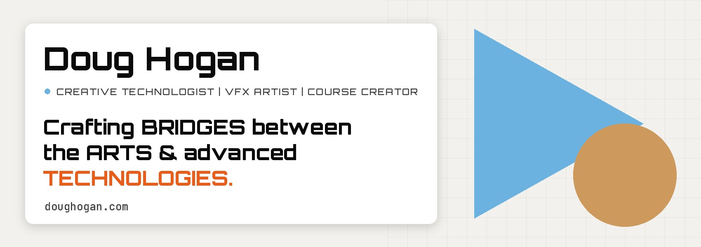

  

  <a href="https://www.doughogan.com"><b>doughogan.com</b></a> &nbsp;·&nbsp;
  <a href="https://www.linkedin.com/in/doughogan/">LinkedIn</a> &nbsp;·&nbsp;
  <a href="https://www.youtube.com/playlist?list=PLadp-whFUHABmL3ZmucZt-1ASZ4GPeATq">Showreels</a> &nbsp;·&nbsp;
  <a href="https://discord.gg/uf2mBpa7u8">fxphdTalk Discord</a> &nbsp;·&nbsp;
  <a href="mailto:doug@doughogan.com">doug@doughogan.com</a>

## Hi, I'm Doug

I'm a Creative Technologist, VFX Artist and course instructor, and I've been working in visual effects for almost 20 years. That career has run through feature films, animation, theme parks, advertising and XR, with credits at studios like Netflix, Disney, Marvel and Universal.

These days most of my time goes into bridging art and advanced technology: building pipelines and tools, putting AI to work in real production, and teaching other artists how to do the same. Everything here is grounded in production experience, not hype.

## What I'm doing now

- **Creative AI/VFX Consultant & Forward Deployed Creative at ComfyUI.** I help major VFX studios adopt ComfyUI in production: demos, workflow development, pipeline integration, and carrying what artists need back to engineering.
- **Nuke Instructor & Community Manager at fxphd.** I make *The Nuke Unfiltered Series* (over 100 hours of compositing and AI training so far) and run the [fxphdTalk](https://discord.gg/uf2mBpa7u8) Discord community.
- **Founder of Dugco Group LLC.** My consulting practice for VFX, AI, education and creative technology, since 2016.

## Open source

Most of what I publish here is tooling for ComfyUI and Nuke that came out of real shots.

| Project | What it is |
| --- | --- |
| **[DUGCO_Tools](https://github.com/dughogan/DUGCO_Tools)** | My growing pack of ComfyUI nodes and workflows for VFX and finishing: a pass viewer, a multi-pass EXR exporter, a film finish and more, with demo videos. |
| [comfy_workflow_audit](https://github.com/dughogan/comfy_workflow_audit) | Evaluates whether a ComfyUI workflow can be used in production. |
| [comfyui-plate-relight](https://github.com/dughogan/comfyui-plate-relight) | VFX nodes: relight a plate while keeping its pixels, temporal deflicker for AI passes, add light from passes with cast shadows. |
| [nuke-alphagen-ofx](https://github.com/dughogan/nuke-alphagen-ofx) | A Nuke OFX plug-in (beta) that brings LTX Alpha-Gen and SAM into Nuke through a Comfy backend. |
| [nuke_mcp](https://github.com/dughogan/nuke_mcp) | An MCP server and tools for Nuke: control Nuke with prompts instead of clicks. |
| [comfy_nuke_nodes](https://github.com/dughogan/comfy_nuke_nodes) | ComfyUI nodes that mimic Nuke workflows and core nodes. |
| [comfyui_qwen_camera_angle_prompter](https://github.com/dughogan/comfyui_qwen_camera_angle_prompter) | Control camera zoom, yaw and pitch with Qwen Image Edit. |
| [switch_which](https://github.com/dughogan/switch_which) | Switch between dynamically generated inputs from a single knob. |
| [comfyui_waitingMusak](https://github.com/dughogan/comfyui_waitingMusak) | Your GPU is working hard. You are on hold. Elevator music for ComfyUI, plus a completion ding. |

## Teaching

I've built and taught courses with fxphd, Pluralsight, Texas A&M and ActionVFX, and I design them to give artists practical skills they can use on their next shot.

- **ActionVFX:** *Intro to ComfyUI for VFX*, *Advanced AI Workflows for Hybrid VFX Pipelines*, *Intro to Nuke*
- **fxphd:** *The Nuke Unfiltered Series*, *AI & Machine Learning Foundations for VFX Artists*, *Crafting Technicolor: Modern Tools for Looks in Nuke*, *Real-World Keying: From Raw Footage to Seamless Composites*
- **Field Guides:** *Comfy 101: General Creative*, the free companion to my ComfyUI General Creative video course, at [doughogan.com](https://www.doughogan.com)
- **Speaking:** AWE USA 2025, AI Dallas Converge 2025, VES Megabrain Insights Live

## Select credits

| | |
| --- | --- |
| **Feature films** | *Thelma the Unicorn* (Netflix), *Space Jam 2*, *Rumble*, *SCOOB!*, *The Book of Life*, *Free Birds* |
| **Theme parks** | *Despicable Me: Minion Mayhem*, *Transformers: The Ride*, *King Kong* and *The Simpsons Ride* for Universal Studios |
| **Commercial** | Oakley with Patrick Mahomes (on-set VFX Supervisor), Amazon, Ford, Samsung, Sony PlayStation, Shinola, Katy Perry's "Firework" |
| **Before that** | Compositing & Matte Painting Supervisor at Reel FX, Creative Technologist & VFX Supervisor at Cheil North America, Senior Creative Technologist at Groove Jones |

## Toolbox

`Nuke` · `ComfyUI` · `Python` · `Maya` · `Blender` · `Lighting` · `Rendering` · `Compositing` · `Generative AI` · `Unreal Engine` · `AR / VR`

B.F.A. in Visual Effects & Film & Television, Savannah College of Art and Design. AI certifications from IBM and MIT.

---

Based in Baton Rouge, LA &nbsp;·&nbsp; <a href="https://www.doughogan.com">doughogan.com</a>

